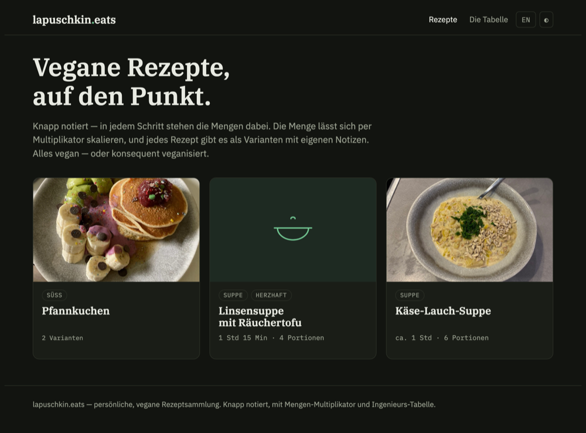
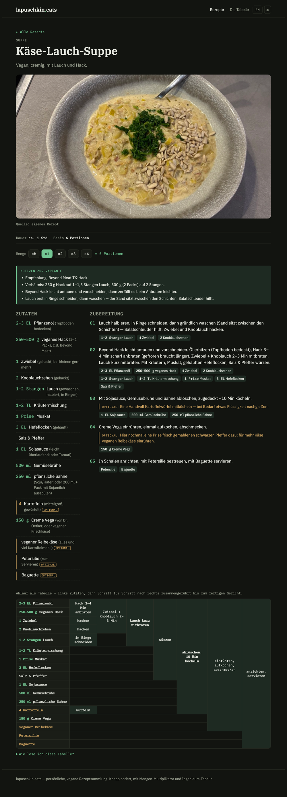

# lapuschkin.eats

> **Heads-up: this is very fucking much WIP, and initially German only.**

My private recipe collection — the dishes the way I actually cook them, written to get to the point. No eight-page life story before the ingredient list, no scrolling back and forth: every step lists its own amounts, the quantity scales with a multiplier, and recipes come as variants (different milk, with or without potatoes, …) with my own notes on what actually worked.

Each recipe also gets the old *Cooking for Engineers* dependency table, because I like seeing the whole flow at a glance.

**Live:** https://sebastian-lapuschkin-sideprojects.github.io/lapuschkin.eats/

## What it looks like

**Overview**

**A recipe**

## What this is

- **The point:** preserving my recipes, the way I make them, in a form that's quick to read and easy to keep — terse instructions, real amounts, my own notes.
- **Data first:** every recipe is a plain JSON file in [`recipes/`](recipes/) — readable in a terminal, `jq`-friendly. The website is just one view of that data. How to write one by hand: [`docs/DATENMODELL.md`](docs/DATENMODELL.md).
- **Vegan:** everything is vegan or veganized.
- **Language:** German first. There's a DE/EN switch and English lives in the data model, but coverage is partial — treat English as best-effort.

## About the code

Full honesty: the technical side of this is **heavily vibe-coded** (with Claude), on purpose. It's a dead-simple static page — `index.html` + `app.js` + the JSON — kept deliberately scrappy so the tech doesn't distract from the actual point, which is preserving my stuff. Don't read the code for craft; read the recipes.

## License

Content (recipes, notes, photos) is **CC BY-NC 4.0** — share and adapt freely, **non-commercial**, with attribution. See [`LICENSE`](LICENSE).
